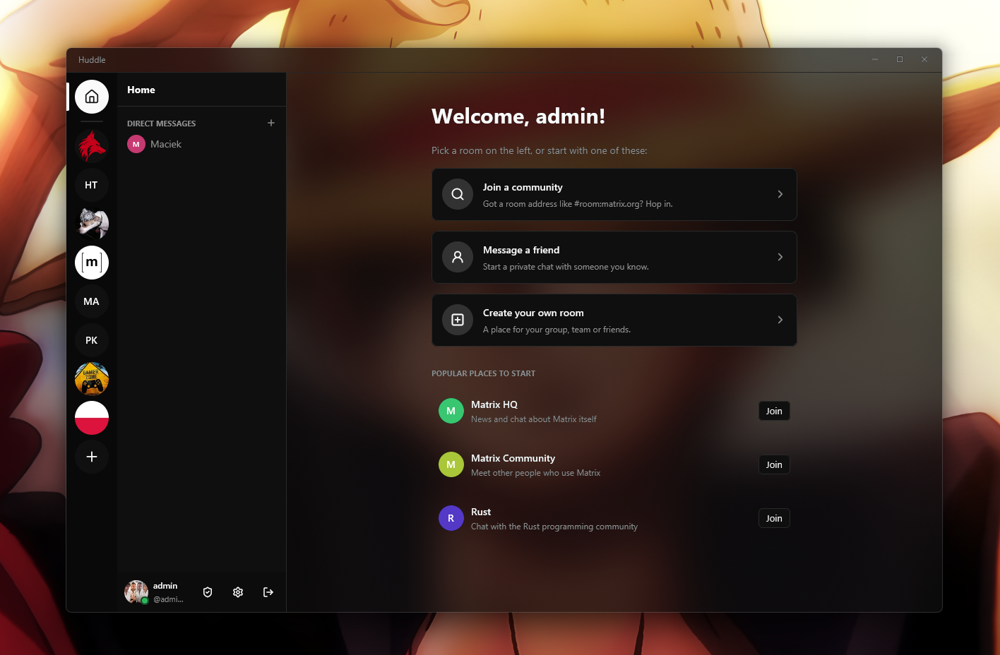
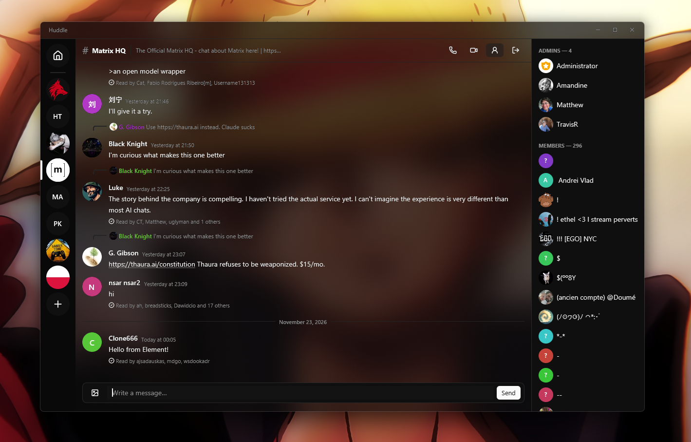

<p align="center">
  
</p>

<h1 align="center">Huddle</h1>

<p align="center">
  <strong>Native Matrix desktop client</strong><br>
  Encrypted chat, rooms, threads, calls, and media - built with Rust and GPUI.
</p>

<p align="center">
  <a href="https://github.com/Cattens-Roses/Huddle/releases/latest"></a>
  <a href="https://github.com/Cattens-Roses/Huddle/stargazers"></a>
  <a href="https://github.com/Cattens-Roses/Huddle/network/members"></a>
  <a href="https://github.com/Cattens-Roses/Huddle/issues"></a>
  <a href="https://github.com/Cattens-Roses/Huddle/actions/workflows/ci.yml"></a>
  <a href="COPYING"></a>
</p>

## Showcase

<p align="center">
  
</p>

<p align="center">
  
</p>

## Features

- **Rooms & DMs** - join rooms, message people directly, and follow threads
- **Encryption** - end-to-end encrypted messaging with Matrix
- **Calls** - voice and video calling from the desktop client
- **Native media** - upload and play images plus common audio/video formats without a browser or FFmpeg install
- **Notifications** - per-category desktop alerts, previews, and taskbar attention
- **Cache** - disk and memory media caches with size limits and one-click clear
- **Appearance** - customizable UI using the shared GPUI design system
- **Desktop extras** - system tray, background presence, and packaged Linux/Windows builds
- **Auto-updates** - Windows in-app differential updates; Linux apt / dnf / pacman repos

## Install

Package repos and install commands live at
[cattens-roses.github.io/Huddle](https://cattens-roses.github.io/Huddle/).
Rolling binaries are also on the [beta](https://github.com/Cattens-Roses/Huddle/releases/tag/beta) release.

### Linux (apt / Debian / Ubuntu)

```sh
curl -fsSL https://cattens-roses.github.io/Huddle/huddle.sources \
  | sudo tee /etc/apt/sources.list.d/huddle.sources
sudo apt update
sudo apt install huddle
```

### Linux (dnf / Fedora / AlmaLinux / RHEL)

```sh
sudo tee /etc/yum.repos.d/huddle.repo <<'REPO'
[huddle]
name=Huddle
baseurl=https://cattens-roses.github.io/Huddle/rpm
enabled=1
gpgcheck=0
REPO
sudo dnf install huddle
```

### Linux (pacman / Arch)

```sh
sudo tee -a /etc/pacman.conf <<'REPO'

[huddle]
SigLevel = Optional TrustAll
Server = https://cattens-roses.github.io/Huddle/arch/
REPO
sudo pacman -Sy huddle
```

### Linux (AppImage)

Download `Huddle-*-x86_64.AppImage` from the
[beta release](https://github.com/Cattens-Roses/Huddle/releases/tag/beta):

```sh
chmod +x Huddle-*-x86_64.AppImage
./Huddle-*-x86_64.AppImage
```

### Windows

Install [Huddle-Setup.exe](https://github.com/Cattens-Roses/Huddle/releases/tag/beta) (per-user). The app checks the rolling `beta` channel and applies changed files in place.

### Beta builds

Every push to `main` refreshes the rolling [beta](https://github.com/Cattens-Roses/Huddle/releases/tag/beta) prerelease (`.deb`, `.rpm`, AppImage, Arch package, Windows setup/exe, and update blobs) and republishes the apt / dnf / pacman repos.

## How to run

```sh
cargo run -p baseapp
```

1. Launch Huddle.
2. Sign in to your Matrix homeserver.
3. Open rooms, DMs, or threads and chat as usual.
4. Optional: configure **Settings → Notifications**, **Cache**, **Updates**, and appearance.

## Building from source

Requires a recent Rust toolchain (see `rust-toolchain.toml`) and platform UI/media dependencies.

```sh
cargo check -p baseapp
cargo run -p baseapp
cargo test -p baseapp matrix::
```

On Linux, install ALSA development headers for playback (e.g. `libasound2-dev` on Debian/Ubuntu), plus the usual X11/Wayland and fontconfig build packages used by GPUI.

Media regression tests use fixtures under `crates/baseapp/tests/media`. An optional system-audio smoke test:

```sh
cargo test -p baseapp system_audio_and_video_playback_smoke -- --ignored
```

## Project layout

- `crates/baseapp` - app shell, Matrix client, media, calls, settings, updater
- `crates/ui` - GPUI components and theme tokens
- `crates/icons` / `crates/i18n` / `crates/embed` - icons, localization, embedding helpers
- `assets` - app icon and UI icon sets
- `packaging` - Linux `.deb` / `.rpm` / AppImage / Arch, Windows installer, update manifests
- `flatpak` / `nix` - Flatpak and Nix flake support
- `.github` - CI, beta release, apt/dnf/pacman repo publish, issue templates

The Cargo package remains `baseapp`; its executable is `huddle` (`huddle.exe` on Windows).
Windows releases ship it as `Huddle.exe`. Build an installer with
`scripts/windows/build-installer.ps1 -Version 0.42.2` after a release build.
The installer uses `assets/windows/huddle.ico`; after changing that icon, run
`python scripts/generate-windows-wizard.py` to refresh its wizard panels (requires Pillow).

## Updates

On Windows, **Updates > Download updates** controls background update downloads
independently of automatic version checks. Turning it off cancels the current
download. Downloaded updates ask before restarting: choose **Restart now** or
**Later**, then use **Updates > Install update** when ready.

## Room and space settings

Use the settings button in a room header, or **Space settings** in a space sidebar.
The panel manages the name, topic, icon, addresses, join rules, allowed spaces,
history visibility, guest access, public directory listing, and encryption.
Administrators can change default permission levels and member roles, invite,
remove, ban, and unban users. Space settings also manage linked rooms, their order,
and whether they are suggested, and can create new rooms. Actions use current Matrix permissions; enabling
encryption is permanent. Room IDs and room versions are shown as information.

## Profile

**Edit profile** supports a display name, photo, About me, pronouns, website,
and time zone. Additional public fields depend on homeserver capabilities and
are shown on Huddle profile cards. When a room is open, you can also set a nickname
just for that room. Unsupported fields remain read-only; leaving a supported
additional field blank removes it.

## Read receipts

Read markers show who has reached a message. Click **Read by** or the read-receipt
button in a message toolbar to see who has read it, including readers who have
already continued to a later message. Main-chat and thread receipts stay separate;
only public receipts shared by other people are shown.

## Media notes

Chat attachments support images plus MP4/M4V, MOV, MKV, WebM, MP3, M4A, AAC, WAV, FLAC, and Ogg/OGA (up to 20 MB). Playback uses native Rust decoders, GPUI video rendering, and system audio. Video containers support H.264, 8-bit HEVC, and VP9 with AAC, MP3, FLAC, PCM, or Opus audio.

## Contributing

See [CONTRIBUTING.md](CONTRIBUTING.md). Please follow the
[Code of Conduct](CODE_OF_CONDUCT.md). Security reports go through
[SECURITY.md](SECURITY.md), not public issues. Privacy notes are in
[PRIVACY.md](PRIVACY.md).

## License

GPL-3.0-or-later. See [COPYING](./COPYING) and [THIRD-PARTY.md](./THIRD-PARTY.md).
